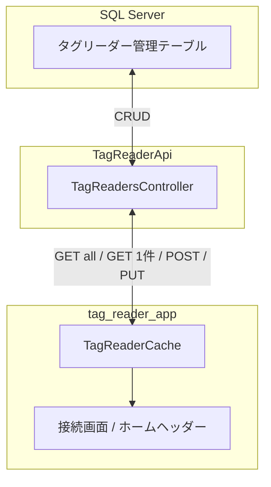
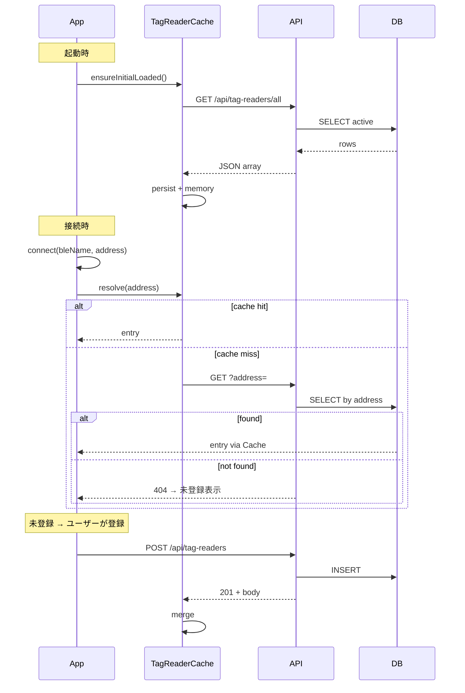

# タグリーダー管理（計画）

**状態**: 計画（未実装）  
**記録日**: 2026-09-01

---

## 目的

社内で複数台の TSS 系タグリーダー（R-5000 / SR-7 等）を運用する際、Bluetooth デバイス名 `R-5000(16DBC3)` だけでは現場で区別しづらい。  
**管理番号**（例: `R-001`）と **表示名**（例: `本社・検査用`）を DB で一元管理し、アプリから参照・編集できるようにする。

---

## 背景・前提

### 個体識別子

| 項目 | 内容 |
|------|------|
| **接続キー（`device_address`）** | Android: Bluetooth MAC（例: `AA:BB:CC:16:DB:C3`）。iOS: CoreBluetooth の UUID 文字列（MAC は OS から取得不可） |
| **BLE 名（`ble_name`）** | リーダー本体がアドバタイズする名前（例: `R-5000(16DBC3)`）。TSS SDK の `initReader` に必要で、**変更不可**（SDK にデバイス名変更 API なし） |
| **括弧内 6 桁** | BLE 名のサフィックス。多くの場合 MAC 末尾と一致するが、**表示・識別の正規キーではない** |

### 既存コードとの関係

| 既存 | 役割 | 本機能との関係 |
|------|------|----------------|
| `ConnectedDeviceStorage` | 接続中デバイスの `id`（address）+ `name`（BLE 名）を端末ローカル保存 | 接続処理は従来どおり BLE 名 + address を使用。表示は本機能のキャッシュを優先 |
| `rememberReaderDevice`（Android）/ `knownBondedStyleDevices`（iOS） | 過去接続リーダー一覧 | 一覧表示時に管理番号・表示名をマージ |
| `ProductUpdateRequest.device_id` | 読取ログ用の任意フィールド | 将来、管理番号または address を送る想定（本計画の Phase 2 以降） |

### 参照パターン

担当者マスタ（`EmployeeCache` + `GET /api/employees/all`）と同様の **一括キャッシュ + オンデマンド 1 件取得 + 永続化** を踏襲する。

---

## 全体構成



---

## DB 設計

### テーブル: `[dbo].[タグリーダー管理]`

自社 SQL Server に **新規テーブル** を追加する（既存業務テーブルとは独立）。

| 列名 | 型 | NULL | 説明 |
|------|-----|------|------|
| `id` | `INT IDENTITY(1,1)` | NOT NULL | 主キー |
| `device_address` | `NVARCHAR(64)` | NOT NULL | 個体の正規キー（MAC または iOS UUID）。**UNIQUE** |
| `ble_name` | `NVARCHAR(128)` | NULL | 最後に接続したときの BLE 名（接続・照合用。更新可） |
| `management_number` | `NVARCHAR(32)` | NOT NULL | 管理番号（例: `R-001`）。**UNIQUE** |
| `display_name` | `NVARCHAR(64)` | NOT NULL | 表示名（例: `本社・検査用`） |
| `reader_model` | `NVARCHAR(32)` | NULL | 機種（例: `R-5000`）。BLE 名プレフィックスから自動設定可 |
| `mac_address` | `NVARCHAR(32)` | NULL | SDK `getMacAddress` で取得した MAC（iOS 接続後に補完。Android は `device_address` と同一のことが多い） |
| `is_active` | `BIT` | NOT NULL | 1=有効、0=廃止・論理削除。既定 1 |
| `created_at` | `DATETIME2(0)` | NOT NULL | 登録日時（サーバー時刻） |
| `updated_at` | `DATETIME2(0)` | NOT NULL | 最終更新日時 |

#### 制約・インデックス

- `PK`: `id`
- `UQ`: `device_address`
- `UQ`: `management_number`（社内で番号の重複を防ぐ）
- `IX`: `is_active`（一覧取得のフィルタ用）

#### DDL 案

```sql
CREATE TABLE [dbo].[タグリーダー管理] (
    [id]                 INT IDENTITY(1,1) NOT NULL,
    [device_address]     NVARCHAR(64)  NOT NULL,
    [ble_name]           NVARCHAR(128) NULL,
    [management_number]  NVARCHAR(32)  NOT NULL,
    [display_name]       NVARCHAR(64)  NOT NULL,
    [reader_model]       NVARCHAR(32)  NULL,
    [mac_address]        NVARCHAR(32)  NULL,
    [is_active]          BIT           NOT NULL CONSTRAINT DF_タグリーダー管理_is_active DEFAULT (1),
    [created_at]         DATETIME2(0)  NOT NULL CONSTRAINT DF_タグリーダー管理_created_at DEFAULT (SYSUTCDATETIME()),
    [updated_at]         DATETIME2(0)  NOT NULL CONSTRAINT DF_タグリーダー管理_updated_at DEFAULT (SYSUTCDATETIME()),
    CONSTRAINT PK_タグリーダー管理 PRIMARY KEY CLUSTERED ([id]),
    CONSTRAINT UQ_タグリーダー管理_device_address UNIQUE ([device_address]),
    CONSTRAINT UQ_タグリーダー管理_management_number UNIQUE ([management_number])
);
```

#### 配置 DB

| 環境 | 備考 |
|------|------|
| ローカル開発 DB | テーブル作成・読み書きテスト |
| テスト DB（Azure 経由） | アプリ実機テスト。`Database:ReadOnly=false` であること |
| 本番 DB | 運用開始前に DDL 適用。本番 API の `ReadOnly=true` 時は **GET のみ**（登録・更新は拒否） |

---

## API 設計

コントローラー: `TagReadersController`（新規）  
ベースパス: `/api/tag-readers`

### エンドポイント一覧

| メソッド | パス | 用途 |
|----------|------|------|
| GET | `/api/tag-readers/all` | 有効なリーダー一覧（アプリ起動時キャッシュ用） |
| GET | `/api/tag-readers` | 1 件取得（クエリ `address` 必須。キャッシュ未ヒット時） |
| POST | `/api/tag-readers` | 新規登録（接続後・未登録時） |
| PUT | `/api/tag-readers/{id}` | 管理番号・表示名等の更新 |

> `DELETE` は Phase 1 では不要。論理削除（`is_active=0`）は将来検討。

### GET /api/tag-readers/all

有効（`is_active=1`）な全件を返す。

**レスポンス 200**

```json
[
  {
    "id": 1,
    "deviceAddress": "AA:BB:CC:16:DB:C3",
    "bleName": "R-5000(16DBC3)",
    "managementNumber": "R-001",
    "displayName": "本社・検査用",
    "readerModel": "R-5000",
    "macAddress": "AA:BB:CC:16:DB:C3",
    "updatedAt": "2026-09-01T09:00:00"
  }
]
```

件数は数十台規模を想定（一括取得で問題なし）。`EmployeeCache` と同様、クライアント容量は数 KB 程度。

### GET /api/tag-readers?address={device_address}

**200** … 上記オブジェクト 1 件  
**404** … 未登録

`address` は大文字小文字・コロン有無を API 側で正規化して照合する（Android MAC の表記ゆれ対策）。

### POST /api/tag-readers

**Body**

```json
{
  "deviceAddress": "AA:BB:CC:16:DB:C3",
  "bleName": "R-5000(16DBC3)",
  "managementNumber": "R-001",
  "displayName": "本社・検査用",
  "readerModel": "R-5000",
  "macAddress": "AA:BB:CC:16:DB:C3"
}
```

| フィールド | 必須 | 説明 |
|------------|------|------|
| `deviceAddress` | ○ | 個体キー |
| `managementNumber` | ○ | 管理番号（重複時 409） |
| `displayName` | ○ | 表示名 |
| `bleName` | - | 接続時の BLE 名 |
| `readerModel` | - | 機種 |
| `macAddress` | - | 接続後に取得できた MAC |

**201** … 作成したオブジェクト  
**400** … バリデーションエラー  
**409** … `device_address` または `management_number` 重複  
**403** … `Database:ReadOnly=true` のとき

### PUT /api/tag-readers/{id}

**Body**（部分更新可）

```json
{
  "managementNumber": "R-001",
  "displayName": "本社・倉庫A",
  "bleName": "R-5000(16DBC3)"
}
```

**200** … 更新後オブジェクト  
**404** … id 不存在  
**409** … 管理番号重複

---

## アプリ設計（tag_reader_app）

### 新規: `TagReaderCache`

`lib/services/tag_reader_cache.dart`（仮称）。`EmployeeCache` を参考に実装。

| 責務 | 内容 |
|------|------|
| 永続化 | SharedPreferences に JSON 一覧 + `lastUpdated` |
| メモリ | `device_address` → `TagReaderEntry` の Map |
| 起動時 | `ensureInitialLoaded` で `GET /api/tag-readers/all` |
| 解決 | `resolve(address)` でキャッシュ → API 1 件 → null |
| 更新 | POST/PUT 成功後にメモリ・永続を更新 |

#### 起動時フロー

`HomeScreen._loadAll()` のバックグラウンド処理に追加（担当者・商品・タグ台帳と並列）。

```
アプリ起動
  → TagReaderCache.init()        … 前回永続キャッシュをメモリ展開
  → ensureInitialLoaded(api)       … GET /all で全件取得し差し替え（TTL は EmployeeCache と同様 24h または毎回取得でも可）
  → 失敗時は SnackBar（オフライン時は前回キャッシュを継続使用）
```

#### 接続時フロー

```
接続成功（address + bleName 確定）
  → entry = TagReaderCache.resolve(address)
       1. メモリ/永続にあれば返す
       2. なければ GET /api/tag-readers?address=...
       3. ヒットすればキャッシュにマージして返す
       4. 404 なら null（未登録）
  → entry != null
       表示: 「接続中: {managementNumber} {displayName}」
       副表示（任意）: BLE 名を小さく
  → entry == null
       表示: 「接続中: {bleName}（未登録）」
       接続画面に「リーダーを登録」ボタン / ダイアログを表示
```

#### 未登録時の登録 UI

**接続画面**（`DeviceConnectionScreen`）で、接続済みかつ `resolve` が null のとき:

- 「リーダー登録」ボタン → ダイアログまたは簡易フォーム
  - 管理番号（必須、形式例: `R-001`）
  - 表示名（必須）
  - 読取専用: BLE 名・address（自動入力）
- 送信 → `POST /api/tag-readers`
- 成功 → キャッシュ更新、ヘッダー表示を管理番号・表示名に切替

#### 編集 UI

接続画面のペアリング済み一覧、または設定画面に「リーダー管理」サブ画面（Phase 1 は接続画面内で十分）。

- 登録済み行: 管理番号・表示名を表示。タップで編集 → `PUT`
- BLE 名・address は参照のみ（接続に必要なため）

#### 表示フォーマット（案）

| 状態 | ホームヘッダー |
|------|----------------|
| 登録済み | `接続中: R-001 本社・検査用` |
| 未登録 | `接続中: R-5000(16DBC3)（未登録）` |
| オフラインでキャッシュあり | 登録済みと同様（Stale 可） |
| 未接続 | 従来どおり非表示 |

接続画面の一覧:

```
タイトル: R-001 本社・検査用
サブタイトル: R-5000(16DBC3) / AA:BB:CC:16:DB:C3
```

### ApiClient 追加（計画）

| メソッド | API |
|----------|-----|
| `fetchTagReadersAll` | GET `/api/tag-readers/all` |
| `fetchTagReaderByAddress` | GET `/api/tag-readers?address=` |
| `createTagReader` | POST `/api/tag-readers` |
| `updateTagReader` | PUT `/api/tag-readers/{id}` |

### モデル（計画）

`lib/models/tag_reader.dart` … API DTO とキャッシュエントリ

---

## シーケンス（接続〜表示）



---

## エラー・オフライン

| 状況 | 挙動 |
|------|------|
| 起動時 GET /all 失敗 | 前回 SharedPreferences を使用。Snackbar で通知 |
| 接続時 GET 1 件失敗 | 未登録扱いにせず、BLE 名のみ表示 + 「登録・同期できませんでした」 |
| POST/PUT 失敗 | エラーメッセージ表示。ローカルには保存しない（サーバーが正） |
| ReadOnly API | POST/PUT を UI で無効化。GET のみ |
| Windows モック（`supportsNativeRfid=false`） | キャッシュ・API は呼ばない、またはモックデータで画面確認 |

---

## 実装フェーズ（提案）

### Phase 1（MVP）

1. DB: `[タグリーダー管理]` 作成（ローカル + テスト DB）
2. API: GET all / GET 1件 / POST / PUT + DTO + ReadOnly ガード
3. アプリ: `TagReaderCache` + ApiClient + 起動時一括取得
4. アプリ: 接続時 `resolve` + ホーム・接続画面の表示変更
5. アプリ: 未登録時の登録ダイアログ + 登録済みの編集

### Phase 2（連携強化）

- `POST /api/product-updates` の `device_id` に **管理番号** を送る
- SDK `getMacAddress` を接続後に取得し `mac_address` を UPDATE（iOS の address 統合）
- 管理画面（Web）または Excel インポート（必要なら）

### Phase 3（運用）

- 論理削除・履歴
- 保管場所・担当者との紐付け（任意）

---

## テスト観点

| # | 内容 |
|---|------|
| 1 | 起動 → GET all → 接続 → キャッシュヒットで管理番号表示 |
| 2 | キャッシュを消去 → 接続 → GET 1 件で表示 |
| 3 | 未登録リーダー接続 → 登録 → 即表示更新 |
| 4 | 管理番号重複 POST → 409 と UI エラー |
| 5 | 同一 address 再 POST → 409 |
| 6 | オフライン起動 → 前回キャッシュ表示 |
| 7 | ReadOnly 環境 → 登録ボタン非表示 |
| 8 | Android MAC / iOS UUID それぞれで address キーが一致 |

---

## 未決事項

| 項目 | 候補 | 決定タイミング |
|------|------|----------------|
| 管理番号の形式 | `R-001` 固定 / 自由入力 | Phase 1 着手前 |
| キャッシュ TTL | 24h（Employee 同様）/ 毎回 all 取得 | 実装時（台数少なら毎回でも可） |
| iOS の `device_address` | UUID のみ / 接続後 MAC を別列で統合 | Phase 2 |
| 本番 DB への書き込み | テスト DB のみ / 本番も可 | 運用方針に合わせる |
| 登録権限 | 誰でも POST 可 / 担当者コード必須 | セキュリティ要件次第 |

---

## 関連ドキュメント

| ドキュメント | 内容 |
|--------------|------|
| [APIエンドポイント一覧.md](./APIエンドポイント一覧.md) | 全 API 総覧（計画分を追記予定） |
| [担当者API.md](./担当者API.md) | キャッシュパターンの参照実装 |
| [商品更新API.md](./商品更新API.md) | `device_id` 連携 |
| [クライアントキャッシュ容量見積もり.md](./クライアントキャッシュ容量見積もり.md) | 端末キャッシュ方針 |
| tag_reader_app `lib/services/employee_cache.dart` | クライアントキャッシュの参照コード |
| tag_reader_app `lib/services/connected_device_storage.dart` | 接続状態のローカル保存 |
